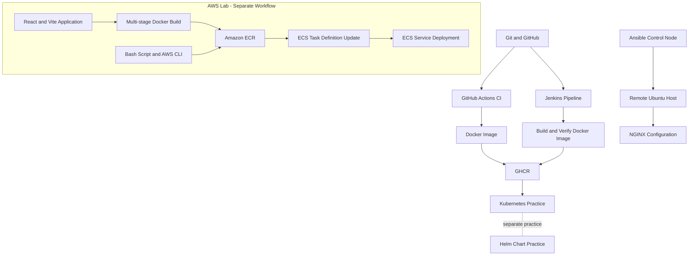

# QuickServe - DevOps Portfolio

**Hands-on DevOps projects from Linux fundamentals to Kubernetes and AWS**

**[View QuickServe Live](https://gitwithkomal.github.io/QuickServe/)**

[](https://www.kernel.org/)
[](https://www.docker.com/)
[](https://kubernetes.io/)
[](https://helm.sh/)
[](https://www.jenkins.io/)
[](https://www.ansible.com/)
[](https://github.com/features/actions)
[](https://aws.amazon.com/)
[](https://nginx.org/)

QuickServe is a hands-on DevOps practice repository exploring how application code can be validated, containerized, published, deployed, and managed using modern DevOps tools.

The repository brings together GitHub Actions, Jenkins, Docker, GitHub Container Registry (GHCR), Kubernetes, Helm, and Ansible. A separate React + Docker + AWS lab explores container image publishing to Amazon ECR and deployment updates through Amazon ECS using the AWS CLI.

## Project Overview

The repository contains two related but separate areas of practice:

- **QuickServe:** A lightweight static web application served by NGINX, with CI workflows, container image publishing, Kubernetes manifests, a Helm chart, and an Ansible configuration-management lab.
- **React Docker AWS Deployment Lab:** A React application built with Vite, a multi-stage Dockerfile, and NGINX, accompanied by a Bash deployment script designed to publish an image to Amazon ECR and update an Amazon ECS service.

The goal is to build practical DevOps experience through implementation, testing, troubleshooting, and documentation.

## Technology Stack

| Area                        | Technologies                                 |
| --------------------------- | -------------------------------------------- |
| Source control              | Git, GitHub                                  |
| CI automation               | GitHub Actions                               |
| CI/CD pipeline              | Jenkins                                      |
| Containerization            | Docker, NGINX                                |
| Container registry          | GitHub Container Registry (GHCR), Amazon ECR |
| Container orchestration     | Kubernetes                                   |
| Kubernetes packaging        | Helm                                         |
| Configuration management    | Ansible                                      |
| Cloud deployment lab        | Amazon ECS, AWS CLI                          |
| Frontend lab                | React, Vite                                  |
| Scripting and configuration | Bash, YAML                                   |

## Architecture and Workflows

The diagram below shows the repository's main practice areas. The AWS deployment lab is separate from the main QuickServe Kubernetes workflow.



### 1. Source Control and GitHub Actions

Code is maintained in GitHub. The CI workflow runs on pushes and pull requests, checks that the application entry file exists, and prints the configured `APP_ENV` repository variable.

A separate workflow builds the Docker image and publishes it to GHCR when changes are pushed to `main`. Images are tagged with `latest` and the corresponding commit SHA.

### 2. Jenkins Pipeline

The Jenkins pipeline practices a container image delivery workflow:

- Verify required source files.
- Build the Docker image with build-number and `latest` tags.
- Check that the image contains the expected application file and QuickServe content.
- Authenticate to GHCR using Jenkins credentials and push the image.
- Clean up locally built image tags after execution.

### 3. Kubernetes and Helm

The repository includes Kubernetes Deployment and Service manifests and a Helm chart with configurable values and templates for resources such as Deployments, Services, Ingress, and optional autoscaling or HTTPRoute configuration.

These resources support hands-on practice with deployment configuration, replica management, resource requests and limits, chart rendering, and Kubernetes networking.

### 4. Ansible Configuration Management

The Ansible lab uses a control node to configure a remote Ubuntu machine. Its playbook installs NGINX, configures it to listen on port `8080` because Apache already occupies port `80`, validates the configuration, and manages the service.

The playbook was rerun successfully with no additional changes, demonstrating idempotent configuration management.

See [`labs/ansible-nginx/README.md`](./labs/ansible-nginx/README.md) for the lab details.

### 5. React + Docker + AWS Deployment Lab

Location: [`labs/react-docker-aws/`](./labs/react-docker-aws/)

This separate lab contains a React application built with Vite, a multi-stage Dockerfile, NGINX configuration, and a Bash deployment script.

The intended workflow is:

1. Install dependencies and build the React production bundle.
2. Build a Docker image using the multi-stage Dockerfile.
3. Authenticate to Amazon ECR and push the image.
4. Retrieve an existing ECS task definition and update its container image.
5. Register a new task-definition revision.
6. Update the ECS service and wait for the service to become stable.

The `deploy.bash` script uses the AWS CLI, Docker, and `jq`. It expects the relevant AWS account access, ECR repository, ECS cluster, ECS service, and task definition to be configured.

The script provides configurable defaults for the AWS region and resource names. Review these values and your AWS permissions before running it.

**Verification status:** The React production build completed successfully with `npm run build`. Docker image execution and a successful ECS deployment should be verified separately before being described as completed.

See the [AWS lab README](./labs/react-docker-aws/README.md) for its local build, Docker commands, and deployment details.

## Repository Structure

```text
QuickServe/
├── .github/
│   └── workflows/
│       ├── ci.yml
│       ├── docker.yml
│       └── static.yml
├── app/
│   └── index.html
├── k8s/
│   ├── deployment.yaml
│   └── service.yaml
├── labs/
│   ├── ansible-nginx/
│   │   ├── README.md
│   │   └── nginx-setup.yml
│   └── react-docker-aws/
│       ├── src/
│       ├── nginx-config/
│       ├── Dockerfile
│       ├── deploy.bash
│       └── README.md
├── quickserve-chart/
│   ├── Chart.yaml
│   ├── values.yaml
│   ├── values-dev.yaml
│   └── templates/
├── compose.yaml
├── Dockerfile
├── Jenkinsfile
├── quickserve-ingress.yaml
└── README.md
```

## Run QuickServe Locally with Docker

### Prerequisites

- Docker installed and running.
- Git, if cloning the repository.

### 1. Clone the repository

```bash
git clone https://github.com/GitWithKomal/QuickServe.git
cd QuickServe
```

### 2. Build the image

```bash
docker build -t quickserve:local .
```

### 3. Start the container

```bash
docker run --rm -p 8081:80 quickserve:local
```

Open `http://localhost:8081` in your browser on the same machine running Docker.

The port mapping `8081:80` maps host port `8081` to container port `80`. Choose another available host port if needed.

### 4. Verify the HTTP response

In a second terminal, run:

```bash
curl -I http://localhost:8081/
```

A successful response should include:

```text
HTTP/1.1 200 OK
Server: nginx
```
The Docker build and HTTP response have been verified locally.

Press `Ctrl+C` in the container terminal to stop the test container. The `--rm` option removes the container when it stops; it does not delete the built image.

## Run with Docker Compose

The repository includes a Compose configuration for running the QuickServe container.

```bash
docker compose up -d
docker compose ps
```

The Compose file uses the `quickserve:1.0` image and maps host port `8080` to container port `80`. Build the image with the expected tag before starting Compose, and ensure host port `8080` is available.

```bash
docker build -t quickserve:1.0 .
docker compose up -d
docker compose ps
```
To stop the service:

```bash
docker compose down
```

## Kubernetes and Helm Practice

Useful local commands include:

```bash
kubectl get deployments,services
kubectl get pods
helm lint ./quickserve-chart
helm template quickserve-practice ./quickserve-chart
```

These commands inspect Kubernetes resources and validate or render the Helm chart without necessarily installing or changing a release.

For actual deployment, ensure your Kubernetes context, image reference, and values are correct before applying changes.

## Ansible Lab

The Ansible NGINX lab covers:

- Inventory configuration and SSH connectivity.
- Installing NGINX with Ansible.
- Managing IPv4 and IPv6 listeners.
- Resolving an Apache/NGINX port conflict.
- Validating NGINX configuration and service state.
- Testing the HTTP response.
- Verifying idempotency across repeated playbook runs.

See the lab's README for the commands, implementation details, and verification results.

## Current Scope and Limitations

QuickServe is a learning and portfolio repository focused on practical DevOps workflows. Its workflows and labs demonstrate individual automation and deployment capabilities; they should not be interpreted as a fully integrated production platform.

The GitHub Actions CI workflow currently performs lightweight source-file verification rather than a comprehensive application test suite. The Kubernetes, Helm, and Ansible components are maintained as separate learning exercises. The React + Docker + AWS lab is also separate, and the presence of its deployment script does not itself confirm a successful ECS deployment.

Further testing, monitoring, and automation improvements can be added as they are implemented and verified.

## Author

**Komal Nimje**

Software Engineer | DevOps

- GitHub: [GitWithKomal](https://github.com/GitWithKomal)
- LinkedIn: [Komal Nimje](https://www.linkedin.com/in/komal-nimje-71593a286/)

This repository documents a practical learning journey through containerization, CI/CD, orchestration, configuration management, and cloud deployment.
