# QuickServe | DevOps Engineering Portfolio

<p align="center">
  <a href="https://gitwithkomal.github.io/QuickServe/">🌐 Live Demo</a> |
  <a href="https://github.com/GitWithKomal/QuickServe">📂 Source Code</a> |
  <a href="https://github.com/GitWithKomal/QuickServe/actions">⚙️ CI/CD Workflows</a> |
  <a href="https://github.com/GitWithKomal/QuickServe/actions/runs/42997207347">☁️ AWS Deployment Proof</a>
</p>

**Building, automating, deploying, and monitoring applications through hands-on DevOps engineering.**

<p align="center">
  <a href="https://gitwithkomal.github.io/QuickServe/"><strong>Live Application</strong></a> ·
  <a href="https://github.com/GitWithKomal/QuickServe"><strong>Source Code</strong></a> ·
  <a href="https://github.com/GitWithKomal/QuickServe/actions"><strong>GitHub Actions</strong></a>
</p>

<p align="center">
  
  
  
  
  
  
  
  
  
  
  
  
  
  
  
  
  
  
  
  
  
</p>

---

## Overview

**QuickServe** is a hands-on DevOps engineering portfolio project focused on understanding and implementing application delivery workflows, containerization, cloud deployment, infrastructure configuration, orchestration, and observability.

The project brings together practical exercises and implementation work using Git, GitHub, GitHub Actions, Jenkins, Docker, GitHub Container Registry (GHCR), AWS, Kubernetes, Helm, Ansible, Prometheus, and Grafana.

The central QuickServe application is a lightweight static web application served by NGINX. Its deployment workflow demonstrates how a code change can move through automated image building, registry publishing, AWS authentication, remote deployment, and application verification.

Additional sections of the repository contain separate Kubernetes, Helm, Ansible, monitoring, and React/AWS practice environments.

## Project Highlights

- Automated Docker image building and publishing with GitHub Actions.
- Container image versioning using `latest` and Git commit SHA tags.
- GitHub Actions authentication to AWS using OpenID Connect (OIDC).
- Remote EC2 deployment using AWS Systems Manager Run Command.
- Docker-based application delivery with NGINX.
- Kubernetes Deployment, Service, and Helm chart practice.
- Local multi-node Kubernetes experimentation using Minikube.
- Ansible-based NGINX configuration management on Ubuntu.
- Local monitoring and observability using Prometheus, Blackbox Exporter, Grafana, and Alertmanager.
- Separate React, Docker, Amazon ECR, and ECS deployment scripting lab.

---

## 1. Technology Stack

| Category | Tools and Technologies |
|---|---|
| Version control | Git, GitHub |
| CI/CD automation | GitHub Actions, Jenkins |
| Containerization | Docker, Docker Compose |
| Container registry | GitHub Container Registry (GHCR), Amazon ECR lab |
| Cloud platform | AWS |
| AWS services | EC2, IAM, Systems Manager (SSM) |
| Authentication | GitHub OIDC, IAM role federation |
| Web server | NGINX |
| Container orchestration | Kubernetes, Minikube |
| Kubernetes packaging | Helm |
| Configuration management | Ansible |
| Monitoring | Prometheus, Blackbox Exporter |
| Visualization | Grafana |
| Alerting | Alertmanager |
| Operating systems | Ubuntu Linux, Windows |
| Scripting | Bash, PowerShell |
| Configuration formats | YAML, JSON |
| Frontend practice | React, Vite |

---

## 2. Main AWS Deployment Architecture

The main QuickServe deployment demonstrates an automated CI/CD workflow from GitHub to an AWS EC2 instance.

### Architecture

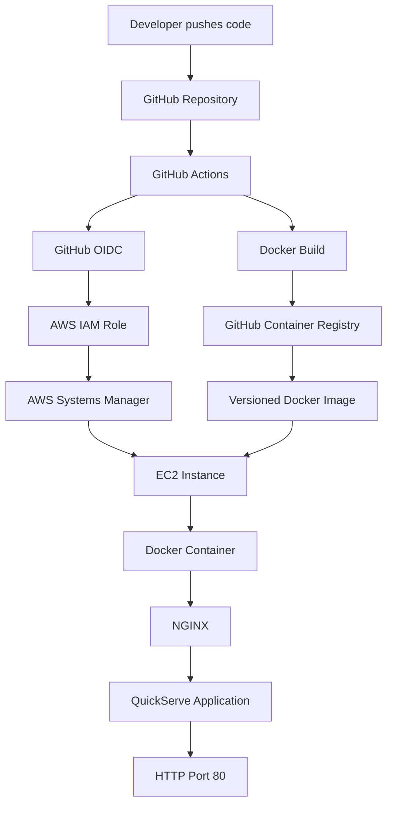

### Deployment Components

| Component | Responsibility |
|---|---|
| GitHub | Source code and version control |
| GitHub Actions | Automated build and deployment workflow |
| Docker | Application containerization |
| GHCR | Docker image storage |
| GitHub OIDC | Short-lived identity federation with AWS |
| AWS IAM | Deployment permissions and access control |
| AWS Systems Manager | Remote command execution on EC2 |
| Amazon EC2 | Cloud compute environment |
| NGINX | Serves the QuickServe application |

### Automated Deployment Process

1. Developer pushes changes to the `main` branch.
2. GitHub Actions checks out the repository.
3. Docker builds the QuickServe image.
4. The image receives two tags:
   - `latest`
   - The corresponding Git commit SHA.
5. GitHub Actions publishes the image to GHCR.
6. GitHub Actions requests AWS credentials through OIDC.
7. AWS IAM validates the federated identity and grants the permitted role.
8. The workflow sends a deployment command through AWS Systems Manager.
9. EC2 pulls the new image from GHCR.
10. Docker replaces the previous QuickServe container.
11. NGINX serves the updated application over HTTP.

### Example Image Tags

```text
ghcr.io/gitwithkomal/quickserve:latest
ghcr.io/gitwithkomal/quickserve:<commit-sha>
```

Using commit SHA tags makes it possible to identify the image associated with a particular source revision.

### AWS Security Approach

The workflow uses GitHub OIDC instead of storing long-lived AWS access keys in GitHub repository secrets.

Security practices implemented include:

- Federated authentication through GitHub OIDC.
- IAM role-based permissions.
- Repository and branch-specific trust restrictions.
- AWS Systems Manager for remote deployment.
- EC2 security group restrictions for network access.
- IMDSv2 requirement in the EC2 configuration.

---

## 3. CI/CD with GitHub Actions

The repository contains separate GitHub Actions workflows for application validation, Docker publishing, and GitHub Pages deployment.

| Workflow | Purpose |
|---|---|
| `ci.yml` | Lightweight source validation |
| `docker.yml` | Docker image build, GHCR publishing, and conditional AWS deployment |
| `static.yml` | GitHub Pages publishing |

### Docker CI/CD Workflow

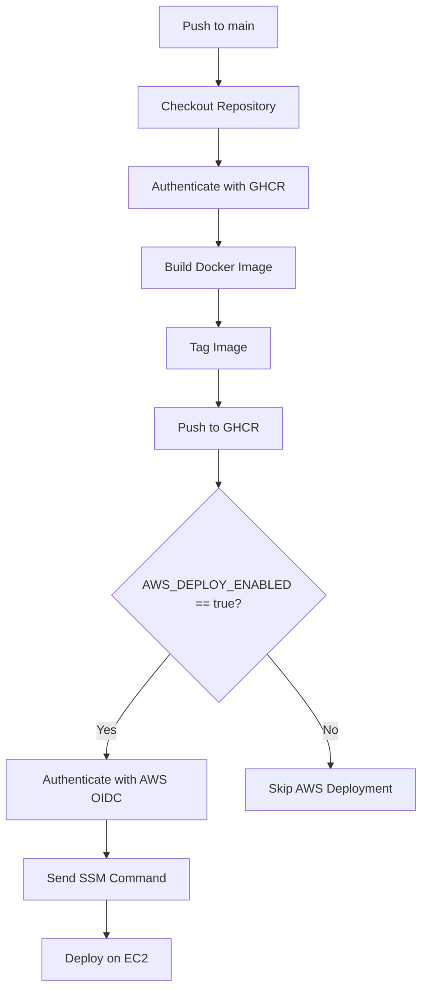

The AWS deployment job is controlled through the repository variable `AWS_DEPLOY_ENABLED`. This allows image publishing to continue without attempting deployment when the EC2 environment is unavailable.

### Workflow History

[View QuickServe GitHub Actions](https://github.com/GitWithKomal/QuickServe/actions)

[View successful AWS deployment run](https://github.com/GitWithKomal/QuickServe/actions/runs/42997207347)

---

## 4. Jenkins Pipeline

The repository also includes a Jenkins pipeline for practicing Docker image delivery.

The pipeline covers:

- Checking required source files.
- Building a Docker image.
- Applying build-number and `latest` tags.
- Validating expected application content.
- Authenticating with GHCR using Jenkins credentials.
- Publishing the image.
- Cleaning up locally built image tags.

**Purpose:** Understand how Jenkins can automate repeatable build, verification, and image publishing stages.

The Jenkins workflow is a separate practice pipeline from the GitHub Actions AWS deployment.

---

## 5. Docker and Containerization

QuickServe uses Docker to package the NGINX-based application into a portable container image.

### Docker Capabilities Practiced

- Dockerfile creation.
- Image building and tagging.
- Container lifecycle management.
- Port mapping.
- Restart policies.
- Registry authentication and publishing.
- Docker Compose.
- Container inspection and troubleshooting.

### Build and Run Locally

**Prerequisites**

- Git
- Docker Desktop or Docker Engine

Clone the repository:

```bash
git clone https://github.com/GitWithKomal/QuickServe.git
cd QuickServe
```

Build the image:

```bash
docker build -t quickserve:local .
```

Run the container:

```bash
docker run --rm -p 8081:80 quickserve:local
```

Open:

```text
http://localhost:8081
```

Verify the HTTP response:

```bash
curl -I http://localhost:8081/
```

A successful response should include:

```text
HTTP/1.1 200 OK
Server: nginx
```

### Docker Compose

The repository also includes a Compose configuration.

Build the expected image:

```bash
docker build -t quickserve:1.0 .
```

Start the service:

```bash
docker compose up -d
```

Inspect running services:

```bash
docker compose ps
```

Stop the environment:

```bash
docker compose down
```

---

## 6. Kubernetes and Helm

The repository contains Kubernetes manifests and a Helm chart for practicing container orchestration.

### Kubernetes Concepts Practiced

- Pods and containers.
- Deployments and replica management.
- Services and networking.
- Container image pulling.
- Resource requests and limits.
- Horizontal Pod Autoscaling (HPA).
- Multi-node cluster concepts.
- Pod scheduling and node troubleshooting.
- Kubernetes configuration and YAML validation.

### Kubernetes Architecture

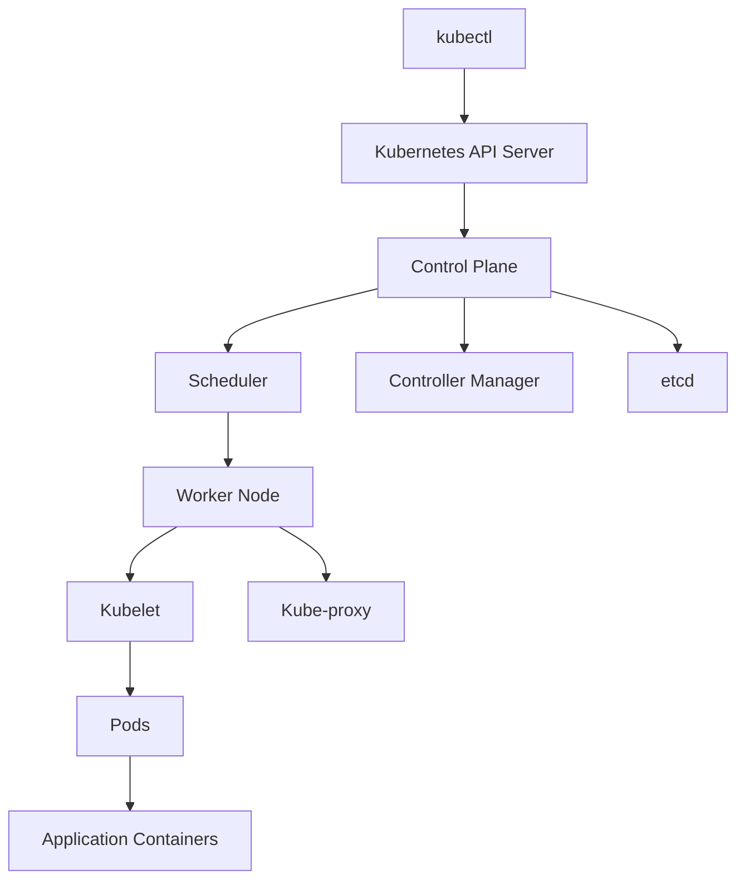

The project includes local Kubernetes experimentation using Minikube. These exercises are separate from the AWS EC2 deployment and do not represent an EKS deployment.

### Helm

The `quickserve-chart/` directory contains a Helm chart with configurable values and templates for Kubernetes resources.

Helm practice includes:

- Chart structure.
- `Chart.yaml` and values files.
- Template rendering.
- Deployment and Service templates.
- Ingress configuration.
- Optional autoscaling and HTTPRoute configuration.
- Environment-specific values.

### Useful Commands

```bash
kubectl get nodes
kubectl get pods
kubectl get deployments,services
kubectl describe pod <pod-name>
kubectl get events --sort-by=.metadata.creationTimestamp
```

Validate the chart:

```bash
helm lint ./quickserve-chart
```

Render the templates:

```bash
helm template quickserve-practice ./quickserve-chart
```

These commands support local inspection and validation. Apply resources only after confirming the active Kubernetes context and configuration.

---

## 7. Ansible Configuration Management

The repository contains an Ansible NGINX configuration lab using a controller and remote Ubuntu host.

### Architecture

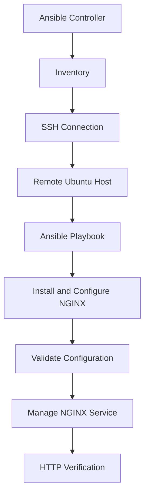

### Practical Work

- Controller and managed-node setup.
- Inventory configuration.
- SSH connectivity.
- Package installation.
- NGINX configuration.
- Service management.
- Configuration validation.
- HTTP response testing.
- Idempotency verification.

The lab configures NGINX on port `8080` because Apache was already occupying port `80` on the target machine.

A successful repeated playbook execution with no additional changes demonstrated idempotent configuration management.

See [Ansible Lab README](./labs/ansible-nginx/README.md).

---

## 8. Monitoring and Observability

QuickServe includes a separate local Kubernetes monitoring environment.

The monitoring stack uses Prometheus, Blackbox Exporter, Grafana, and Alertmanager.

### Monitoring Architecture

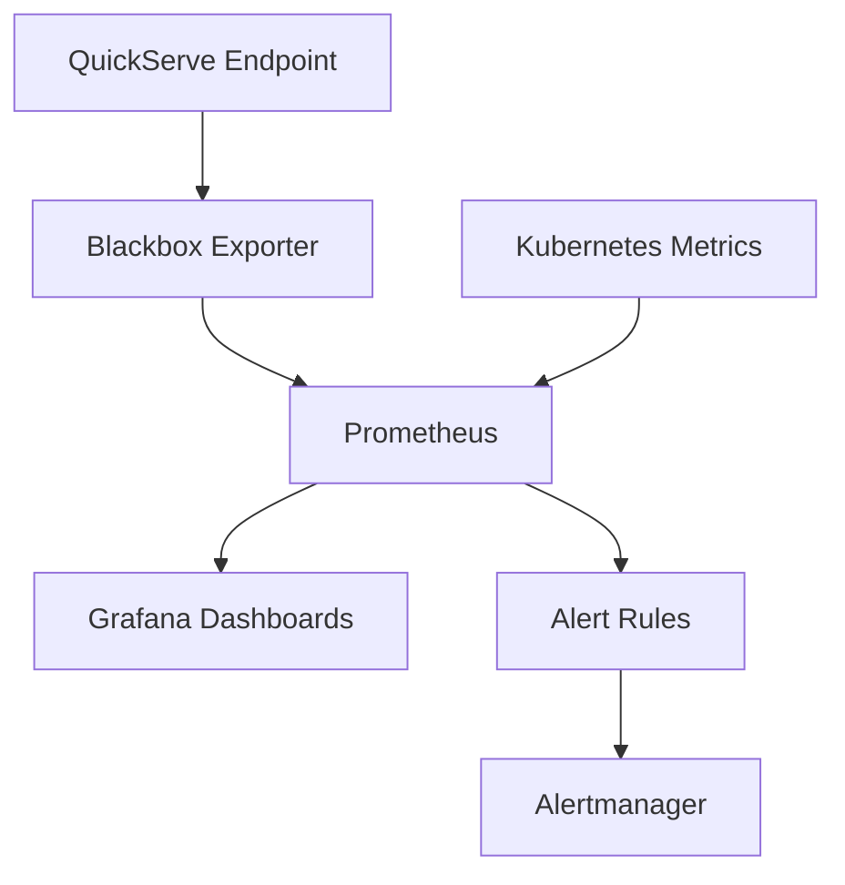

### Tools and Responsibilities

| Tool | Purpose |
|---|---|
| Prometheus | Metrics collection and querying |
| Blackbox Exporter | HTTP endpoint probing |
| Grafana | Dashboard visualization |
| Alertmanager | Alert handling |
| Kubernetes | Local monitoring environment |

### Monitoring Areas

The monitoring exercises cover:

- HTTP endpoint availability.
- Probe success and HTTP status.
- Response-time monitoring.
- Prometheus scrape targets.
- Kubernetes workload metrics.
- Deployment availability.
- Pod CPU and memory usage.
- Container restart counts.
- Node resource utilization.
- Alert configuration.

### QuickServe Operations Dashboard

A Grafana dashboard was configured using Prometheus as its data source to visualize Kubernetes infrastructure and workload metrics.

**Dashboard panels (10):**

- Available, desired and unavailable deployment replicas.
- Cluster CPU utilization.
- Cluster memory utilization.
- QuickServe pod CPU usage.
- QuickServe pod memory usage.
- Pod container restarts.
- Node CPU utilization.
- Node memory utilization.

The dashboard provides visibility into deployment health, workload resource consumption and Kubernetes node utilization.

**Environment:** Local Minikube Kubernetes cluster.

### Dashboard Screenshot

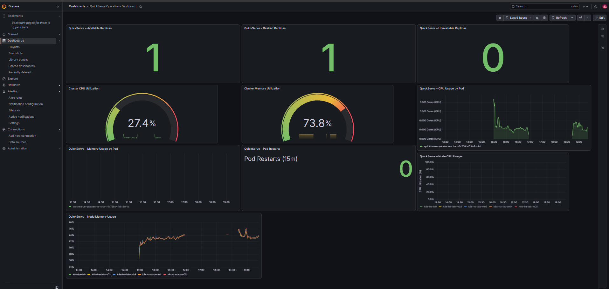

**Exported Dashboard Configuration:** [View Grafana Dashboard JSON](docs/monitoring/quickserve-grafana-dashboard.json)

**Note:** Grafana, Prometheus and Alertmanager run in the local Minikube environment. They are not publicly hosted.

### Local Access

Grafana is accessed through Kubernetes port forwarding:

```bash
kubectl port-forward -n monitoring svc/grafana 3001:80
```

Open:

```text
http://localhost:3001
```

Prometheus:

```bash
kubectl port-forward -n monitoring svc/prometheus-server 9090:80
```

Alertmanager:

```bash
kubectl port-forward -n monitoring svc/prometheus-alertmanager 9093:9093
```

These services run in the local Kubernetes lab. They are not publicly hosted on AWS.

---

## 9. Separate React and AWS ECR/ECS Lab

Location: [`labs/react-docker-aws/`](./labs/react-docker-aws/)

This is a separate cloud deployment practice area containing:

- React application built with Vite.
- Multi-stage Dockerfile.
- NGINX configuration.
- Bash deployment script.
- AWS CLI integration.
- Amazon ECR image publishing workflow.
- ECS task-definition update logic.

### Intended Workflow

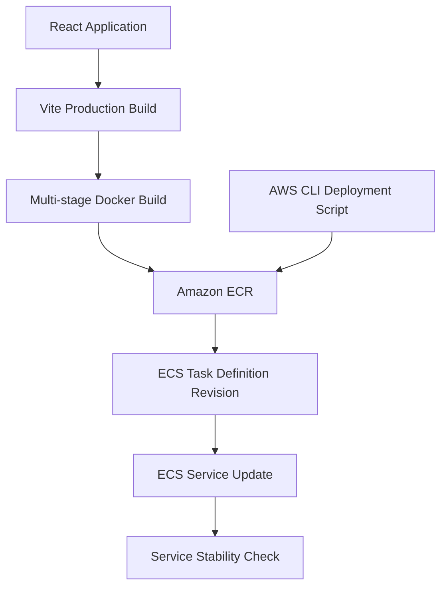

The deployment script uses Docker, AWS CLI, Bash, and `jq`.

**Verification status:** The React production build was verified. The ECR/ECS workflow is maintained as a separate practice lab; the presence of its deployment script should not be interpreted as proof of a completed ECS deployment.

See the [React Docker AWS Lab README](./labs/react-docker-aws/README.md).

---

## 10. AWS Deployment Evidence

The main QuickServe application was successfully deployed to AWS EC2 through GitHub Actions, GHCR, OIDC, and AWS Systems Manager.

The successful test included:

- Docker image build and GHCR publishing.
- GitHub OIDC authentication with AWS.
- SSM command execution.
- Docker container replacement on EC2.
- Successful application access through the EC2 public endpoint.
- Successful GitHub Actions deployment status.

### Screenshots

**GitHub Actions – Successful Workflow**

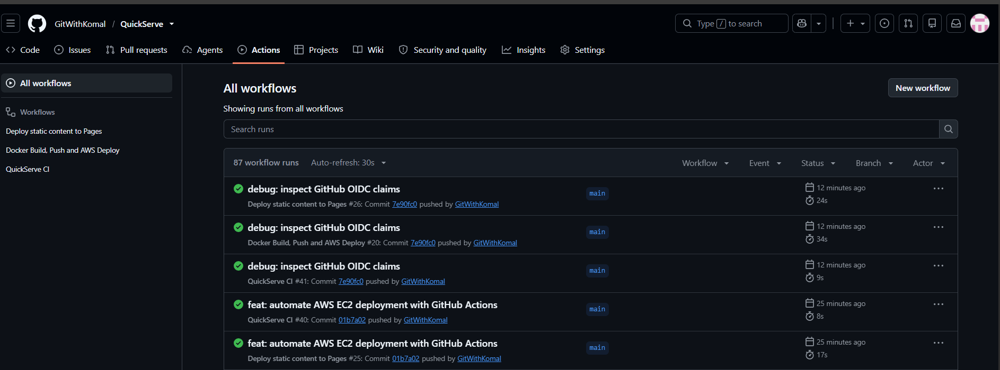

**AWS Systems Manager – Deployment Output**

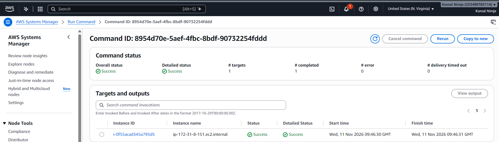

**Grafana – Local Monitoring Dashboard**

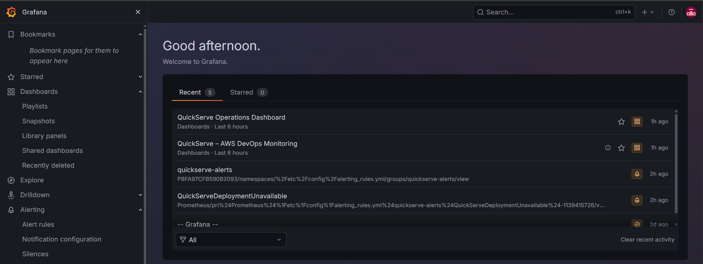

**AWS EC2 – Infrastructure Details**

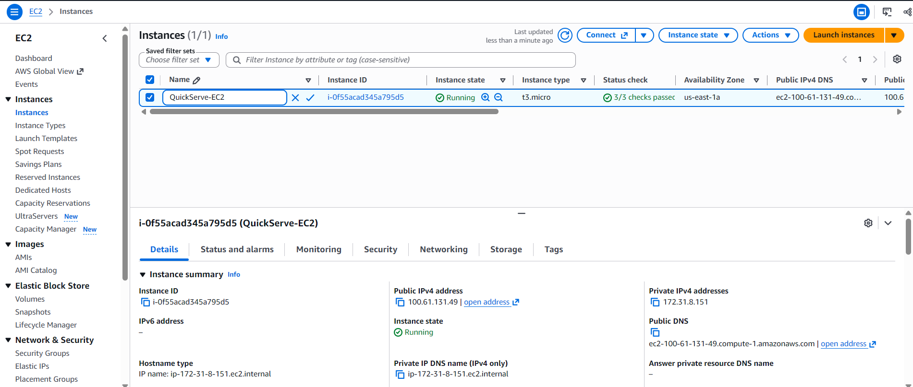

### Deployment Availability and Cost Management

The EC2 environment was used for deployment validation and end-to-end testing. It is intended to be shut down after the evidence is published to avoid unnecessary ongoing cloud compute charges.

The AWS deployment is therefore documented as a successfully tested deployment exercise, not as a permanently available AWS-hosted endpoint.

The GitHub repository, source code, workflow history, and GitHub Pages application remain separate from the EC2 lifecycle.

---

## 11. Repository Structure

```text
QuickServe/
│
├── .github/
│   └── workflows/
│       ├── ci.yml
│       ├── docker.yml
│       └── static.yml
│
├── app/
│   └── index.html
│
├── docs/
│   └── evidence/
│       ├── github-actions-success.png
│       ├── aws-ssm-deployment.png
│       ├── grafana-monitoring.png
│       └── aws-ec2-instance.png
│
├── k8s/
│   ├── deployment.yaml
│   └── service.yaml
│
├── labs/
│   ├── ansible-nginx/
│   │   ├── README.md
│   │   └── nginx-setup.yml
│   │
│   └── react-docker-aws/
│       ├── src/
│       ├── nginx-config/
│       ├── Dockerfile
│       ├── deploy.bash
│       └── README.md
│
├── quickserve-chart/
│   ├── Chart.yaml
│   ├── values.yaml
│   ├── values-dev.yaml
│   └── templates/
│
├── monitoring/
│   └── quickserve-operations-dashboard.json
│
├── compose.yaml
├── Dockerfile
├── Jenkinsfile
├── quickserve-ingress.yaml
└── README.md
```

---

## 12. Troubleshooting and Learning Areas

The project has involved practical troubleshooting across multiple layers of the DevOps workflow.

| Area | Practical learning |
|---|---|
| Docker | Image builds, container startup, port mapping, image pulling |
| GitHub Actions | Workflow execution, job dependencies, registry publishing |
| AWS IAM/OIDC | Trust policy configuration and federated authentication |
| AWS SSM | Remote command execution and deployment status checks |
| EC2 | Instance status, security groups, public access |
| Kubernetes | Pod scheduling, image pulling, node status, events |
| Helm | Chart validation, values, and template rendering |
| Ansible | SSH connectivity, service configuration, idempotency |
| NGINX | Port conflicts, configuration validation, service management |
| Prometheus | Scrape configuration and target monitoring |
| Grafana | Dashboard access and visualization |

---

## 13. Scope and Engineering Practices

QuickServe is a learning and portfolio project demonstrating individual DevOps workflows and practical implementation experience. It is not presented as a fully integrated production platform.

The repository distinguishes between:

- Automated AWS EC2 deployment.
- Local Kubernetes and Helm exercises.
- Local monitoring and observability.
- Separate Ansible configuration-management work.
- Separate React/ECR/ECS deployment scripting practice.

### Practices Followed

- Version-controlled configuration.
- Container image tagging.
- IAM role-based cloud authentication.
- OIDC instead of long-lived AWS access keys in GitHub Actions.
- Remote deployment through SSM.
- YAML-based workflow and infrastructure configuration.
- Separation of local labs and cloud deployment.
- Cloud cost awareness and resource cleanup.
- Documentation of tested functionality and known limitations.

### Future Improvements

- Add automated application tests to the CI workflow.
- Introduce Terraform-managed infrastructure with reviewed state management.
- Expand Kubernetes deployment automation.
- Add more structured application and infrastructure alerts.
- Improve deployment health checks and rollback handling.
- Explore managed Kubernetes and advanced cloud-native deployment patterns.

These are future improvement areas, not claims of already completed implementation.

---

## 14. Run the Project

Clone the repository:

```bash
git clone https://github.com/GitWithKomal/QuickServe.git
cd QuickServe
```

Build and run QuickServe locally:

```bash
docker build -t quickserve:local .
docker run --rm -p 8081:80 quickserve:local
```

Open:

```text
http://localhost:8081
```

For Kubernetes, Helm, Ansible, and monitoring exercises, refer to their respective folders and configurations.

---

## 15. Author

**Komal Nimje**

**Software Engineer | DevOps**

- GitHub: [GitWithKomal](https://github.com/GitWithKomal)
- LinkedIn: [Komal Nimje](https://www.linkedin.com/in/komal-nimje-71593a286)
- Portfolio: [View Portfolio](https://komal-portfolio-nine-alpha.vercel.app)
- QuickServe: [Live GitHub Pages Application](https://gitwithkomal.github.io/QuickServe/)

---

<p align="center">
  <strong>Learn. Build. Automate. Deploy. Monitor. Improve.</strong>
  <br>
  <sub>Documenting a practical journey into DevOps and cloud-native engineering.</sub>
</p>

